<!-- ====================== HEADER ====================== -->
<div align="center">

<a href="https://github.com/MarwenOnGit">
  
</a>

<p>
  <code>⚔️ attack</code> &nbsp;→&nbsp; <code>🛰️ detect</code> &nbsp;→&nbsp; <code>🛡️ prevent</code>
</p>

<p>
  
  
  
  
</p>

</div>

<!-- ====================== INTRO ====================== -->

```text
~ whoami
  Computer-science engineering student. I build Azure & Entra ID security
  tooling in matched sets — the attack, the detection that catches it, and
  the baseline that prevents it — so each project is graded by the next.
  Named after the Norse things that hunt, watch, and guard.
```

<!-- ====================== THE ATTACK CHAIN ====================== -->

### 🧩 One attack path, covered end to end

<table>
  <tr>
    <th align="left" width="130">Stage</th>
    <th align="left" width="200">Project</th>
    <th align="left">What it does</th>
  </tr>
  <tr>
    <td><code>⚔️ attack</code></td>
    <td><a href="https://github.com/MarwenOnGit/fenrir"><b>Fenrir</b></a></td>
    <td>Walks the Azure attack path from a single identity: enumerate the tenant, impersonate managed identities, steal their tokens, harvest what they control.</td>
  </tr>
  <tr>
    <td><code>🛰️ detect</code></td>
    <td><a href="https://github.com/MarwenOnGit/Huginn"><b>Huginn</b></a></td>
    <td>Fenrir's defensive twin: a Sentinel analytics rule for every action it takes, proven nightly by replaying benign versions in a lab and checking the alert fires.</td>
  </tr>
  <tr>
    <td><code>🛡️ prevent</code></td>
    <td><a href="https://github.com/MarwenOnGit/Bastion"><b>Bastion</b></a></td>
    <td>A secure-by-default Azure landing zone in Terraform, with a pipeline that proves the guardrails by trying to break them.</td>
  </tr>
</table>

> Each repo is checked by the next one in the chain — the exploit has to survive the detection, and the detection has to survive the baseline.

<!-- ====================== ALSO PUBLIC ====================== -->

### 📦 Also public

- 🛩️ **[kestrel](https://github.com/MarwenOnGit/kestrel)** — autonomous airborne RF-collection swarm for authorized spectrum monitoring and emitter geolocation.
- 🧪 **[CVE-DETECTION-LAB](https://github.com/MarwenOnGit/CVE-DETECTION-LAB)** — isolated lab for validating high-severity CVEs and writing Suricata / ModSecurity detection signatures.
- 🎣 **[EntraID Adversary Emulation Lab](https://github.com/MarwenOnGit/EntraID_Adversary_Emulation_Lab_Setup)** — AiTM phishing against M365 / Entra ID, with the detection and prevention controls that answer it.

<!-- ====================== STACK ====================== -->

### 🛠️ Stack

<p>
  
</p>

<!-- ====================== STATS ====================== -->

### 📊 By the numbers

<div align="center">


</div>

<!-- ====================== SNAKE ====================== -->

<picture>
  <source media="(prefers-color-scheme: dark)" srcset="https://raw.githubusercontent.com/MarwenOnGit/MarwenOnGit/output/snake-dark.svg" />
  <source media="(prefers-color-scheme: light)" srcset="https://raw.githubusercontent.com/MarwenOnGit/MarwenOnGit/output/snake.svg" />
  
</picture>

<div align="center">
  <sub>⚔️ break it · 🛰️ watch it · 🛡️ guard it</sub>
</div>
